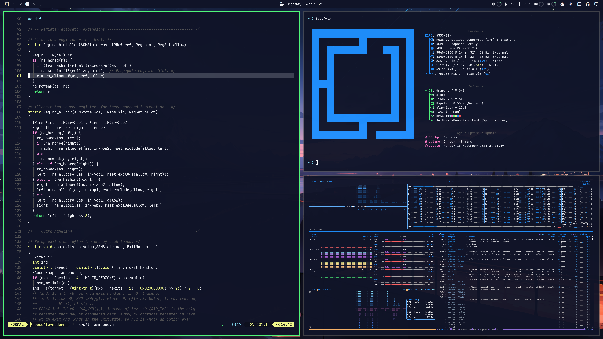
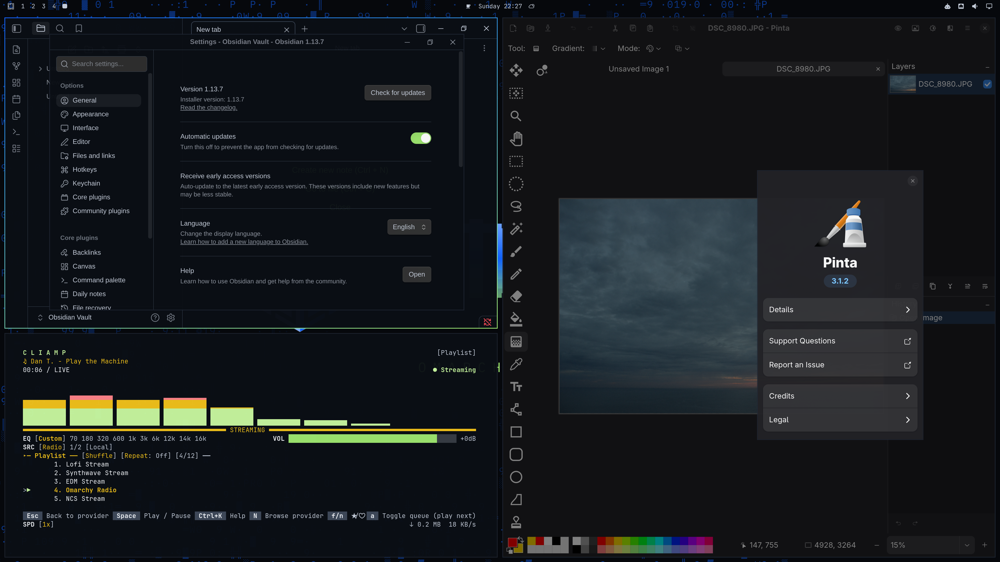
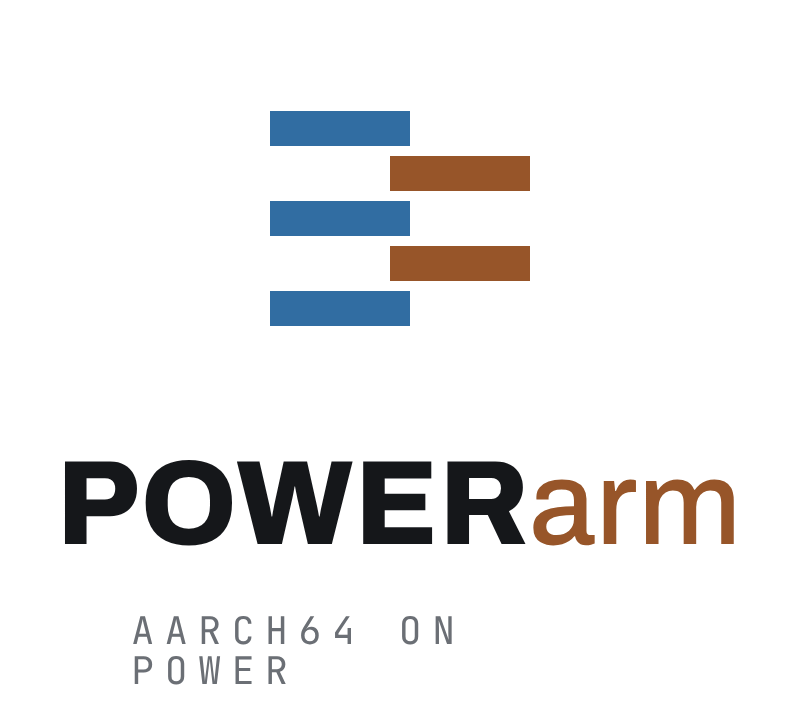
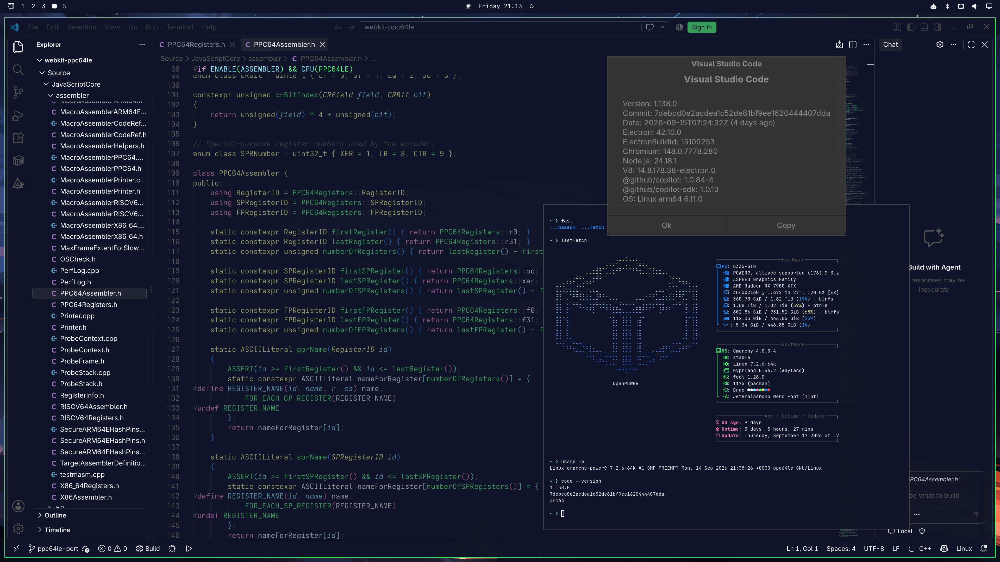
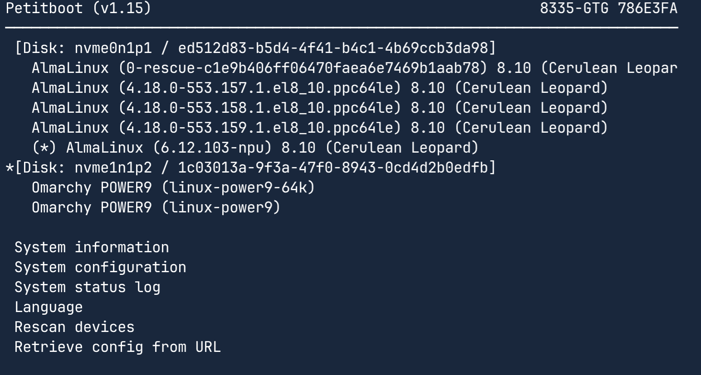
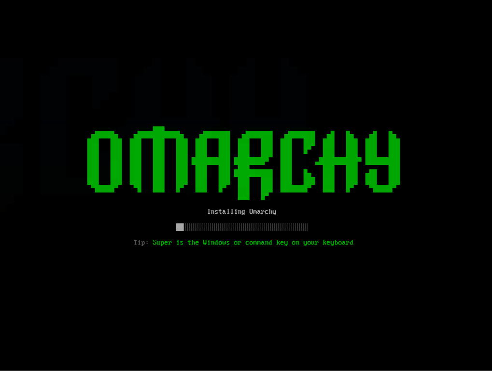
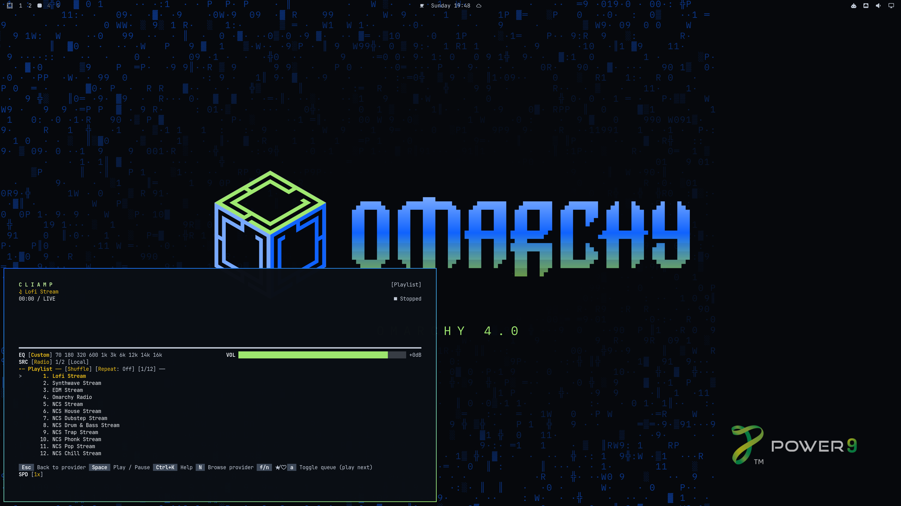
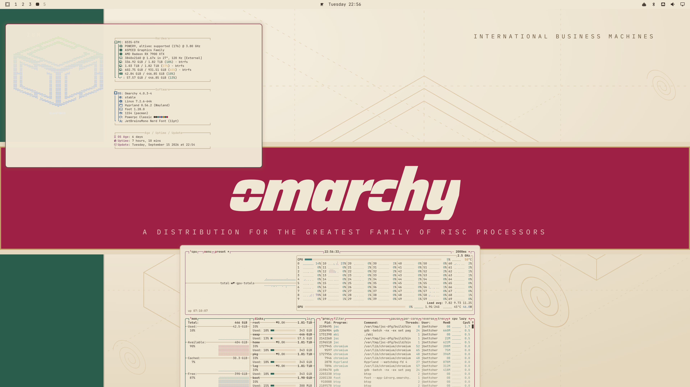
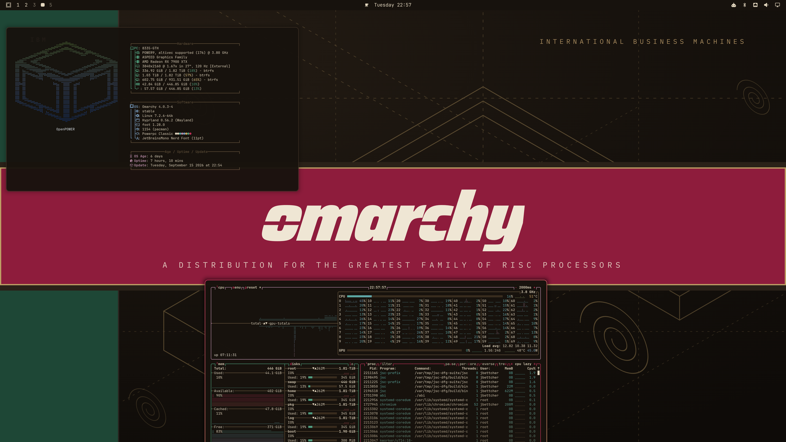

# Omarchy for POWER

[](#status)
[](#status)
[](docs/power8-secondary-target.md)
[](https://github.com/omacom/omarchy)
[](#not-available-yet)
[](https://github.com/jbettcher-wg/omarchy-ppc64le/commits/master)
[](LICENSE)

[Omarchy](https://github.com/omacom/omarchy) (Arch Linux + Hyprland), ported to
**powerpc64le**. It's built on [Arch POWER](https://archlinuxpower.org) and
runs on **POWER8 through POWER11**, with an optional POWER9-optimised pool on
top.



## Status

Omarchy **4.5.0** runs as a daily desktop on an IBM AC922 (8335-GTH, POWER9,
176 threads, Radeon RX 7900 XTX). That includes the Hyprland session, the
Omarchy shell and plugins, Chromium, Neovim with LazyVim on a JIT-enabled
LuaJIT, and `omarchy update`. 4.5 is the first Omarchy release with a platform
model, and POWER is in it as two platforms, `ppc64le` and `ppc64le-power9`
([below](#how-it-differs-from-upstream-omarchy)).

| | |
|---|---|
| Omarchy base packages available | **161 of 162** (only `localsend` is missing, [below](#not-available-yet)) |
| Packages in the `omarchy-ppc64le` pool (baseline, runs on every ppc64le machine) | **1,302** |
| Packages in the `omarchy-power9` pool (POWER9-optimised, opt-in) | **1,664** |
| Build scripts in [omarchy-ppc64le-packaging](https://github.com/jbettcher-wg/omarchy-ppc64le-packaging) | 4,689 pkgbases |
| Omarchy version | 4.5.0, stable channel (`omarchy` 4.5.0-9, `omarchy-settings` 4.5.0-5) |
| Kernel | baseline `linux-omarchy` 7.3.5 (4K pages) and `linux-omarchy-64k`; POWER9 `linux-power9` 7.3.5 and `linux-power9-64k`, with `linux-power9-7.2` (7.2.9) kept as a fallback |
| Latest ISO | `omarchy-2026.09.24-ppc64le.iso` — baseline, installs on any ppc64le machine |
| Installer | ISO + `omp-install`, PowerNV and pSeries |
| Release channel | not public yet; packages are unsigned |

## Package pools

The distribution ships **two package pools**, built from the same recipes. A
build is named for what it *runs on*, not for what it was tuned for.

| pool | built | runs on | role |
|---|---|---|---|
| **`omarchy-ppc64le`** | POWER8-legal (ISA 2.07) | POWER8 → POWER11, i.e. **every ppc64le machine** | **the baseline, and the default.** What the ISO installs from, what the installer writes into `/etc/pacman.conf`, what external testers use |
| `omarchy-power9` | `-mcpu=power9`, ISA 3.0 | POWER9 only | an **opt-in extra** for machines known to be POWER9, layered *ahead* of the baseline |

Layered means exactly what pacman does with repo order: with both configured,
`[omarchy-power9]` is listed first, so an optimised package wins where one
exists and the baseline fills in the rest. Nothing has to be built twice for a
machine to get a complete system — the baseline alone is complete.

How the POWER8-legal build is produced, and which recipes pin an ISA of their
own: [`docs/power8-secondary-target.md`](docs/power8-secondary-target.md).

## Repositories

The distribution is two **git** repositories.

| | |
|---|---|
| **this one** | the installer and ISO, the build tooling, the repo databases, and the docs |
| [**omarchy-ppc64le-packaging**](https://github.com/jbettcher-wg/omarchy-ppc64le-packaging) | every build script the distribution builds from — 4,604 pkgbases |

No PKGBUILD lives here. A builder needs both, and locates the packaging tree
through `OMARCHY_PACKAGING`:

```sh
git clone git@github.com:jbettcher-wg/omarchy-ppc64le.git
git clone git@github.com:jbettcher-wg/omarchy-ppc64le-packaging.git
export OMARCHY_PACKAGING=$PWD/omarchy-ppc64le-packaging
```

Clone them side by side under `~/Development` and the variable is unnecessary —
that is the default the tools assume.

### Notable ports

- **LuaJIT with a working ppc64le JIT backend**
  ([jbettcher-wg/luajit-ppc64le](https://github.com/jbettcher-wg/luajit-ppc64le)).
  It's the first one, as far as we know. Neovim and Omarchy's LazyVim config run
  on it.
- **Chromium 157** in both pools, with Debian's ppc64le patch set and
  POWER9/POWER8 build modes. The baseline build carries our POWER8 V8 patches.
- **Electron 44** in both pools, with **Obsidian** on it.
- **Firefox 154**, with runlevel5's ppc64le SpiderMonkey JIT backend — and our
  fix for an opcode-table bug in it that made every Ion-compiled `Math.min` /
  `Math.max` on doubles execute an ISA 3.0 instruction and SIGILL on POWER8.
- **.NET 10 built from source**, with a fix to Mono's ppc64le JIT for ELFv2
  struct returns, so GTK apps like **Pinta** run. The one-time bootstrap is
  documented in [`docs/dotnet-ppc64le-bootstrap.md`](docs/dotnet-ppc64le-bootstrap.md).
- **Blender 5.3 with Cycles on a native VSX kernel**, in both pools. Arch
  POWER's build (5.1) has Cycles off entirely -- EEVEE and Workbench only --
  because neither `embree` nor `openimagedenoise` existed for POWER. Ours turns
  the Cycles CPU device on with Embree 4.4.1 BVH traversal and the
  OpenImageDenoise 2.4.1 denoiser, and replaces the
  SSE-through-compatibility-headers path with a native 4-wide VSX integrator
  kernel: 2,194 vector fused multiply-adds in the kernel object against 6 for
  the compat build. Cycles lists the device as `IBM POWER9 (VSX)`. It builds
  against our OpenImageIO 3.2 and OSL 1.15.7.
- **An LLD fix for PPC64 thread-local storage.** When LLD 22 relaxes a TLS
  access sequence it rewrites the first instruction with `r3` as its target,
  whatever register the compiler chose. If that was not `r3`, the real one is
  left stale, and the next access reads someone else's memory. GNU ld keeps the
  register. Blender 5.3 hit it as a segfault at GUI start. Our `lld` 22.1.8-1.1 keeps the
  register the compiler chose, and its build links and runs a reproducer for
  each relaxation; Blender now links with GNU ld either way.
- **Ghidra 12.2**, in both pools, with **z3** 5.3.3. Arch POWER has no Ghidra.
  The port adds a `linux_ppc64le` platform to Ghidra's native build and to its
  runtime (without it Ghidra calls the machine unsupported). It builds the way
  x86 does, on **JDK 25** and **Gradle 9.9**, both packaged here because Arch
  POWER has neither. All 39 processor families compile their SLEIGH specs (137 `.sla`
  files), and the decompiler runs natively: headless decompiles of x86-64,
  i386, AArch64, Windows PE (x64 and ARM64) and ppc64le binaries are checked on
  both pools, and the decompiler also passes under `qemu-ppc64le -cpu power8`.
- **KiCad 10.0.8**, in both pools, with the full symbol, footprint and 3D-model
  libraries. Arch POWER has no KiCad. It carries a fix for a crash upstream
  10.0.8 still has: changing any preference while the scripting console
  existed dereferenced a null toolbar configuration.
- **kicad-mcp** as a KiCad 10 IPC plugin, so an agent can drive a running KiCad
  through 28 MCP tools. Its Python stack is packaged too: `python-mcp`,
  `pynng` built against the system nng, and `kicad-python` with its protobuf
  bindings regenerated for protobuf 7.
- **Mozc**, the Japanese input method (`fcitx5-mozc`), in both pools, with
  **Bazel 9.0.2** built from its source release. Upstream's build fetches a
  prebuilt Bazel through bazelisk; on ppc64le every build input comes from
  source or a ppc64le release, protoc included, and the build checks from
  Bazel's execution log that every compile used the pool's `-mcpu`.
- **WebKit's JavaScriptCore with a ppc64le JIT**, one port shared by `jsc`,
  **bun** 1.4.3, `webkit2gtk-4.1` and `webkitgtk-6.0`.
- **Qt 6 WebEngine**
- The full **Hyprland** stack, **quickshell**, and Omarchy's own apps and tools
  (omacalc, omacut, omawrite, tensaku, herdr, cliamp, aether, ttfx, tobi-try).
- Toolchains: **Go 1.27**, **Zig 0.16** (and 0.15 for herdr), **LLVM 22**,
  **Rust 1.99**.
- **ghostty**, **mangohud**, **tailscale** and **cloudflared** ship as a single
  POWER8-legal build each, byte-identical in both pools.
- **ROCm/HIP 7.2.4** and **llama.cpp** for Radeon compute, and **ROCm 10** for
  RDNA3 and RDNA4 in the POWER9 pool (ROCm 10 dropped Vega's gfx900, so the two
  generations are separate, conflicting sets).



### POWERarm: aarch64 software on POWER9

<a href="https://github.com/jbettcher-wg/POWERarm">
  <picture align="right">
    <source media="(prefers-color-scheme: dark)" srcset="docs/images/powerarm-logo-dark.png">
    
  </picture>
</a>

[POWERarm](https://github.com/jbettcher-wg/POWERarm) runs aarch64 binaries on
ppc64le, so software that was never built for POWER still runs on it. Below is
Visual Studio Code -- the **arm64** build, reporting `OS: Linux arm64`, on
Electron 42 / Chromium 148 / Node 24 -- running on Omarchy on an AC922, on our
own 7.2.6 64K-page kernel. The file open in it is `PPC64Assembler.h` from the
ppc64le JavaScriptCore port: an aarch64 editor being used to write POWER code.



POWERarm 0.20.1 and **sleeve** are default packages on every POWER platform.
POWERarm builds each user's aarch64 guest root at login, and sleeve finds the
arm64 desktop apps it runs and writes their launchers, desktop entries and
per-app POWERarm settings.

#### Agent CLIs through mise

Omarchy installs its agent CLIs through mise, and most of them publish no
ppc64le build. On POWER they install as their **arm64** builds and run under
POWERarm. That takes four changes:

- **mise built from source.** Upstream's `mise-bin` is x86_64 and aarch64
  only. Ours carries one patch: mise names little-endian POWER `powerpc64`, as
  Rust does, so it asked nodejs.org for a `linux-powerpc64` tarball that does
  not exist, and fell back to compiling node from source, hours of CPU on
  first use. It now fetches nodejs.org's `linux-ppc64le` build.
- **An aqua registry overlay**, `default/mise/aqua-powerpc64.yaml`. It holds
  the recipes for claude-code, codex, copilot-cli, antigravity-cli, ori, pi,
  hunk and opencode with `powerpc64` mapped to their linux/arm64 asset. Only
  those recipes are replaced; every other aqua tool keeps mise's bundled one.
  uv's entry fetches Astral's native ppc64le build instead, which the stock
  recipe never names. [`tools/mise-aqua-overlay.py`](tools/mise-aqua-overlay.py)
  regenerates the overlay from a pinned aqua-registry commit.
- **`/etc/mise/conf.d/platform-ppc64le.toml`**, which `omarchy-settings` ships
  only on POWER. It points mise at the overlay; disables mise's `gh` and
  `crush`, so the distribution's native builds win; and sends amp, ghui,
  kilocode and freebuff, which are npm launchers for x64/arm64-only binaries,
  to their arm64 release channels.
- **No migrations inside the guest.** A terminal opened in an arm64 app (VS
  Code's, say) is an aarch64 guest with its own pacman database, so
  `omarchy-migrate` refuses to run there and asks for a native terminal.

#### Superwhisper dictation

Superwhisper, Omarchy 4.5's default dictation, is closed source and built for
x86_64 and aarch64 only. On POWER, `superwhisper-bin` installs the vendor's
signed **arm64** build and runs it under POWERarm, so dictation works the same
as on x86. Local transcription runs on the GPU: Parakeet transcribes 7 s of
speech in 1.5 s on the AC922's Radeon. It takes three things:

- **The aarch64 libraries the guest root lacks**: GTK4 for the recording
  indicator and tray icon, and fontconfig and xkbcommon for the settings window.
  The package carries them itself, pinned on POWERarm's package snapshot, so
  it works whatever else a user's guest holds.
- **A native `python3` first on its `PATH`**, so its helper scripts use the
  host's Python and its GTK bindings.
- **A launcher that pins POWERarm's `vk` guest root**, which every POWER install
  builds at login.

The fcitx5 add-on that types text directly is an aarch64 module, which the
host's native fcitx5 cannot load, so dictation is pasted instead.
Muffle, which lowers other audio while recording, is unavailable for the same
reason; Pause works. The recipe and its bump procedure are in
[omarchy-ppc64le-packaging](https://github.com/jbettcher-wg/omarchy-ppc64le-packaging),
`superwhisper-bin/`.

### Not available yet

| Package | Why |
|---|---|
| `localsend` | Flutter app; the Dart VM has no ppc64le back end yet |
| `limine`, `limine-snapper-sync` | not applicable; POWER boots through petitboot (below) |

`omarchy-pkg-add` skips these with a notice, so a migration that installs one
alongside others still runs.

## How it differs from upstream Omarchy

- **Boot.** OpenPOWER firmware boots through **petitboot**, not limine. The
  installer writes a `grub.cfg` that petitboot reads, and a pacman hook keeps
  it current. There are no bootable snapshots; `snapper` is optional.
- **Packages.** They come from our own pool — `[omarchy-ppc64le]` by default,
  optionally `[omarchy-power9]` ahead of it — listed ahead of Arch POWER's
  `[base]` and `[base-any]`, instead of pkgs.omarchy.org.
- **Platforms.** Omarchy 4.5 introduced a platform model:
  `omarchy-hw-platform`, per-platform package lists and pacman templates. We
  add two platforms, `ppc64le` (every POWER machine, POWER8 today) and
  `ppc64le-power9` (which also enables the POWER9 pool), plus
  `install/omarchy-ppc64le-unavailable.packages` for what POWER cannot
  install, and why. They are written in upstream's layout, on a branch that
  could be sent upstream, and carried as patches on the two packages below.
- **`omarchy` and `omarchy-settings` are upstream's packages, repacked.** They
  contain no machine code. The recipes drop the limine/snapper dependencies and
  the update guard hook, and add the platform patches.
- **Hardware support is clipped.** Intel and NVIDIA graphics, Apple T2, x86
  laptop quirks and multilib don't apply;
  [`installer/share/omp-clipped.packages`](installer/share/omp-clipped.packages)
  lists every dropped package and why.

## Using the repository

Add the repo **ahead of** Arch POWER's repos in `/etc/pacman.conf`. The
baseline pool is the one to use unless you know the machine is a POWER9:

```ini
[omarchy-ppc64le]
SigLevel = PackageNever DatabaseOptional TrustAll
Server = https://omappc64le.download/omarchy-ppc64le

[base-any]
Server = https://repo.archlinuxpower.org/base/any

[base]
Server = https://repo.archlinuxpower.org/base/$arch
```

On a POWER9 machine you can layer the optimised pool **ahead of** the
baseline — repo order is what does the overriding, so you get the optimised
build of everything it carries and the baseline for the rest:

```ini
[omarchy-power9]
SigLevel = PackageNever DatabaseOptional TrustAll
Server = https://omappc64le.download/omarchy-power9

[omarchy-ppc64le]
SigLevel = PackageNever DatabaseOptional TrustAll
Server = https://omappc64le.download/omarchy-ppc64le

[base-any]
Server = https://repo.archlinuxpower.org/base/any

[base]
Server = https://repo.archlinuxpower.org/base/$arch
```

The repo is served from Cloudflare R2. Packages are **not signed yet**, which is
why `SigLevel` is `PackageNever DatabaseOptional TrustAll`: `PackageNever` also
stops pacman from asking for `.sig` files, whose 404 page is larger than
pacman's signature size limit and would abort downloads under plain
`Optional`. Signing them is planned.

Many packages here are rebuilds of Arch POWER packages under the same name. If
something from `[omarchy-ppc64le]` or `[omarchy-power9]` misbehaves, report it
here first rather than to Arch POWER.

Updates work through `omarchy update` or plain `pacman -Syu`. `omarchy
update`'s keyring step works as on x86: both pools carry `omarchy-keyring`,
and Arch POWER's `archpower-keyring` provides `archlinux-keyring`. Our
`omarchy` package reports a system using one of our pools as the **stable**
channel.

## Installing

Build the ISO (needs root for `mkarchiso`, plus the
[kth5/archiso](https://github.com/kth5/archiso) fork at `../archiso-power`):

```sh
iso/build.sh                 # baseline: https://omappc64le.download/omarchy-ppc64le
iso/build.sh --power9        # the POWER9-optimised pool instead
iso/build.sh --bundle-repo   # also embeds the pool, to test unpublished packages
iso/build.sh --print-config  # show the resolved pool, db and servers; build nothing
```

The default ISO installs the **baseline** pool, which runs on any ppc64le
machine; `--power9` builds one for the optimised pool, and `--repo-name` /
`--pool` name the two halves by hand. The install needs a network connection:
packages come from our pool and Arch POWER.

Output goes to `iso/out/omarchy-YYYY.MM.DD-ppc64le.iso`, or
`omarchy-power9-YYYY.MM.DD-ppc64le.iso` for `--power9`. The name follows the
pool the image installs, so a baseline ISO that runs on any ppc64le machine
never carries a POWER9 name.

**About the `omp` names.** The installer's programs, variables and paths use
the prefix `omp`, short for *Omarchy for POWER*: `omp-install`,
`omp-configurator`, `omp-firstboot`, `OMP_*` settings, `/usr/local/share/omp`,
`/etc/omp.conf`. They were `p9-*` / `P9_*` / `omarchy-p9` while the port was
POWER9-only. The rename came with the POWER8 baseline pool, because the same
installer now serves both. Systems installed before the rename keep their old
`p9-*` files; nothing migrates them.

Booting it starts
`omp-configurator`, which asks for keyboard, user, disk and timezone, and shows a
summary with the target disk's serial for confirmation. It then runs
`omp-install` under Omarchy's own install dashboard, so the install looks like
upstream's:
- a progress bar driven by the packages actually installed;
- a failure screen with the log tail and options to view the log, reboot or
  drop to a shell;
- a **Reboot Now** prompt when it finishes.

On PowerNV machines the installed system appears in petitboot alongside
anything else on the box, with one entry per installed kernel:





`omp-install` supports **PowerNV** (bare metal: AC922, Talos II, Blackbird and
other skiboot/petitboot machines) and **pSeries** (KVM/PowerVM guests; it adds
a PReP partition and GRUB). The
layout matches upstream: GPT, ext4 `/boot`, btrfs `/` with `@ @home @log @pkg`
subvolumes. Omarchy's configuration runs on first boot through
`omp-firstboot`. See [`installer/README.md`](installer/README.md).

Testing:
- `installer/test/run-guest.sh prepare|serve|install|boot` runs a full install
  and boot in QEMU `powernv9` through petitboot.
- `tests/qemu-smoke.sh` boots the newest ISO as a pSeries guest.
- `tests/installer-dryrun.sh` exercises the installer's argument and safety
  checks.

## Building packages

Everything is built unprivileged. `tools/bq.py` orders the build, layers build
dependencies with `bwrap` overlays (no chroot, no sudo), runs several packages
in parallel and caches compiles with ccache.

Build scripts live in their own repository,
[**omarchy-ppc64le-packaging**](https://github.com/jbettcher-wg/omarchy-ppc64le-packaging)
— every PKGBUILD the distribution builds from, curated by us. Clone it beside
this one, or point `OMARCHY_PACKAGING` at it:

```sh
git clone git@github.com:jbettcher-wg/omarchy-ppc64le-packaging.git \
  ~/Development/omarchy-ppc64le-packaging      # the default location
# edit <category>/<pkg>/PKGBUILD there, bump pkgrel
tools/bq.py build <pkg> [-j N] [--rebuild --force]
tools/repo-publish.sh              # dry run: what would change in omarchy-power9
tools/repo-publish.sh --commit     # write the published DB
REPO=$PWD/repo-ppc64le REPO_NAME=omarchy-ppc64le tools/repo-publish.sh --commit
                                   # ... and the same for the baseline pool
tools/build-ppc64le.sh <pkg>       # build into the baseline pool (POWER8-legal)
```

Recipes are discovered by pkgbase, **recursively**, in that one tree — nothing
else is a build-time source. Arch's GitLab and the AUR are import sources
reached through `tools/fetch.sh`, which places a fetched recipe in the right
category inside the packaging tree, where it is reviewed and committed. That
split is deliberate: when three trees could each supply a recipe, versions
drifted silently between builders. A pkgbase claimed by two directories is an
error, never resolved by picking one, and a recipe older than the version our
repo database ships is refused and logged (`--allow-downgrade` overrides): we
do not downgrade for parity. Every package passes path guards that reject
build-tree paths and stray install locations. Full details are in [`docs/build-queue.md`](docs/build-queue.md).

### Releasing a new Omarchy version

1. Read upstream's `omarchy.db`: filename, `%SHA256SUM%`, depends.
2. Read the new migrations; a failing migration aborts `omarchy update`.
3. Bump `pkgver` and the checksum in `ours/omarchy` and
   `ours/omarchy-settings` in the packaging tree, build, and publish.

## Layout

| Path | Contents |
|---|---|
| `tools/` | `bq.py` build queue, `repo-publish.sh`, dependency closure and soname/repo gap checks, path guards, sysroot helpers |
| `installer/` | `omp-install`, the ISO configurator, first-boot layer, QEMU test rig |
| `iso/` | archiso profile and `build.sh` |
| `tests/` | ISO smoke test, installer dry-run tests |
| `manifest/` | generated dependency closure and build order |
| `docs/` | build system, package status, POWER8 plan, upstreamable patches, investigations |
| `RULES.md` | working rules for this tree |
| `repo-ppc64le/`, `repo/` | the baseline and POWER9-optimised package pools: built packages and repo DBs (not in git) |
| `upstream/` | reference clones of `omarchy` and `omarchy-iso` (not in git) |

Build scripts are not here; see [Repositories](#repositories).

## Upstream work

Portability fixes that belong upstream are tracked in
[`docs/upstreamable-patches.md`](docs/upstreamable-patches.md), for Omarchy,
Arch POWER and individual projects. Patches carry a header saying whether they
are upstreamable or a local workaround.

## License

The tooling, installer, docs and our own recipes and patches are
[MIT](LICENSE). Recipes adapted from Arch Linux, Arch POWER or the AUR, and
patches taken from other projects, keep their original licences; see each
package directory in the packaging repository (`LICENSE`, `REUSE.toml` or the
patch header).

## Credits

- [Omarchy](https://github.com/omacom/omarchy)
- [Arch POWER](https://archlinuxpower.org), the base distribution
- the [PPC64/LuaJIT](https://github.com/PPC64/LuaJIT) interpreter port that the
  JIT backend builds on
- Debian's chromium team (ppc64le patches)
- Fedora (Qt WebEngine ppc64le patches)
- [kth5/archiso](https://github.com/kth5/archiso) (OpenPOWER boot support)

Maintained by Jordan Bettcher.






